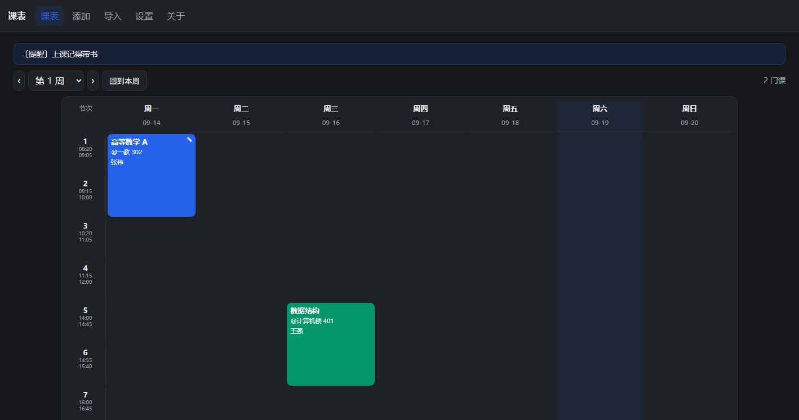
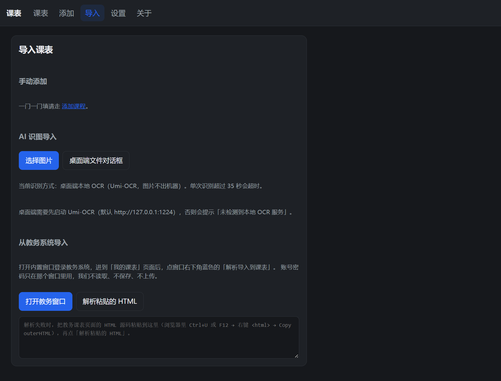
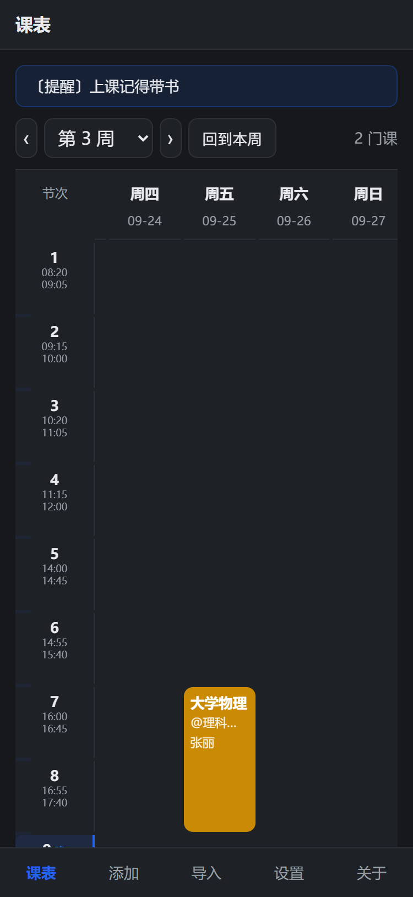

# 课表 · Timetable

本地存储的跨平台课表：Windows 桌面端（Tauri 2）+ Web/PWA。数据只存在你自己的机器上，不上传、不登录、无账号。

> English README coming soon.



## 功能

- **跨平台**：Windows 桌面端（Tauri 2 打包的 exe / NSIS 安装包）+ 浏览器 PWA（可加到主屏幕，离线可用）
- **手动添加课程**：课名、教师、地点、备注、星期、节次、周次、颜色；保存前检测同周同时段冲突
- **AI 识图导入**：桌面端走**本机** Umi-OCR（图片不出机器）；Web 端默认本地模拟，开启上传后才发给你自己配的 OCR 服务
- **教务系统导入**：内置 WebView 打开教务系统，点页面上的按钮抓当前课表页 HTML，由 Rust 本地解析成课程；支持金智教育 `jwapp` 课表结构（另有一条通用表格兜底路径）
- **周次**：`1-16`、`1-8单`、`1-8双`、`1,3,5`、单周 `17`；上一周 / 下一周 / 回到本周，按学期开始日期算，今天高亮
- **自定义节次时间**：每节课的起止时间可增删改，晚自习单独一行并高亮
- **课程备注 + 全局提醒**：备注显示在色块右上角；主页顶部一句可自定义的提醒
- **本地存储**：IndexedDB（Dexie），整份数据可导出/导入 JSON 备份



## 技术栈

| 层 | 用了什么 |
|---|---|
| 桌面外壳 | Tauri 2（Rust） |
| 前端 | React 18 + Vite 5 + TypeScript，无 UI 框架、无 CDN/字体/图片外链 |
| 存储 | IndexedDB（Dexie 4） |
| 后端命令 | Rust：`ocr_image`（本机 Umi-OCR）、`parse_zhengfang`（课表 HTML 解析）、`open_admin`（内置教务窗口）、`http_get` |
| 测试 | `node --test`（前端纯函数）+ `cargo test --lib`（解析器） |

## 开发

```bash
npm install
npm run dev        # http://localhost:5173
```

跑测试：

```bash
npm test                     # 前端：周次/周数、OCR 行解析、默认时间表 —— 21 个用例
npx tsc --noEmit             # 类型检查
cd src-tauri && cargo test --lib   # Rust：课表解析器 —— 16 个用例
```

目录：

```
src/                前端（pages / components / lib，无 UI 框架）
src-tauri/src/      Rust：lib.rs（命令）、admin.rs（课表 HTML 解析器）
test/               node --test 用例
scripts/            构建脚本
```

## 构建

**Web / PWA**

```bash
npm run build      # -> dist/（含 sw.js，可离线）
npm run preview    # 本地预览构建产物
```

**Windows 桌面端**

```powershell
pwsh scripts/tauri-build.ps1 -RunTests
```

脚本会：关掉正在运行的旧 exe（否则链接会失败）→ 前端构建并校验 `dist/` 完整 → `cargo test --lib` → `tauri build` → 校验 exe 里确实嵌入了当前的入口 JS。产物：

- 绿色版：`src-tauri/target/release/timetable.exe`
- 安装包：`src-tauri/target/release/bundle/nsis/课表_0.1.0_x64-setup.exe`

需要 MSVC 构建工具链（脚本会自己注入 `vcvars64.bat`）。

**macOS / Linux**：本仓库目前**没有**打包好的 dmg / AppImage，需要在各自平台上自行构建（`npm run tauri build`）。见下方「已知限制」。

## 部署到 Cloudflare Pages

纯静态，任何静态托管都能用；下面是 Cloudflare Pages（免费、自带 HTTPS，PWA 必须要 HTTPS）。

1. **先推到 GitHub**（Pages 从 Git 仓库构建）：

   ```bash
   cd timetable
   gh repo create timetable --public --source=. --remote=origin --push
   # 或者手动：git remote add origin <仓库地址> && git push -u origin main
   ```

2. Cloudflare 控制台 → **Workers & Pages** → **Create** → **Pages** → **Connect to Git**
3. 选刚才那个仓库，分支 `main`
4. 构建配置：
   - **Framework preset**：`Vite`（或 None）
   - **Build command**：`npm run build`
   - **Build output directory**：`dist`
   - **环境变量**：**一个都不用加**。`vite.config.ts` 里关掉 Service Worker 的条件是 `TAURI_ENV_PLATFORM` 存在——那是 Tauri 构建时才有的变量，Cloudflare 上不存在，所以 **Web 构建照常生成 `sw.js` + `manifest.webmanifest`**（这正是手机上要离线用的前提）。
5. Node 版本用默认的即可（`vite-plugin-pwa` 0.21 + Vite 5 在 Node 18/20/22 上都跑过）
6. 部署完拿到 `https://<项目名>.pages.dev`
7. **手机浏览器**打开这个域名 → 菜单里「添加到主屏幕」/「安装应用」→ 桌面出现课表图标，点开是全屏无地址栏的 standalone 窗口
8. 以后 `git push` 到 `main` 会自动重新部署；手机上打开会自动更新（`registerType: 'autoUpdate'`）

> 也可以把 `dist/` 直接拖给任意静态托管（Vercel：Framework 选 Vite，Build/Output 同上）。**必须 HTTPS**，HTTP 下 Service Worker 不注册，就没有离线能力。

## 手机使用

把 `.pages.dev` 域名加到主屏幕后就是一个独立 App（standalone、无地址栏、可离线）。窄屏做了适配：左侧节次列在横向滑动时钉住、顶部提醒条和周次栏不跟着滚走、底部固定五个标签、点课程色块弹出的是贴底抽屉。

**手机上能用**

- 看课表、切上一周 / 下一周 / 回到本周（今天高亮）
- 手动添加 / 编辑 / 删除课程，改节次时间、全局提醒、课程备注
- 导出 / 导入 JSON 备份（不方便传文件时，可以在设置页把备份 JSON 文本直接粘进来导入）
- **离线使用**：装好后断网也能打开（Service Worker 预缓存了全部资源）

**手机上不能用**

- **教务系统导入**：内置 WebView + 注入按钮是桌面端（Tauri 命令 `open_admin`）的能力，浏览器里没有
- **AI 识图导入（本地 OCR）**：桌面端是把图片发给**本机** `127.0.0.1:1224` 的 Umi-OCR；手机上没有这个服务

**替代方案**

- 教务课表：**电脑上导入 → 设置页「导出 JSON」→ 把备份内容发到手机（微信/QQ 发给自己都行）→ 手机设置页展开「或者直接粘贴备份 JSON 文本」，粘贴后点「导入粘贴的内容」**。不想粘贴也可以把 json 文件传到手机，用「导入 JSON」选文件。导出的就是整份 `{courses, settings}`，手机导入后完全一致（**覆盖**原有课表，不是追加）。
- 识图导入：手机端暂不支持。真要用，得自己搭一个云端 OCR 服务，并在设置里打开「允许上传图片识别」（图片会离开手机，自行权衡）。

> 小坑：manifest 里的启动背景色只有一份，取的是浅色主题的 `#f6f7f9`。手机是深色模式时，启动瞬间会闪一下浅色再变深，属于 PWA 的固有限制（manifest 不能按 `prefers-color-scheme` 分叉）。



## 安卓安装包（自用）

不上架、不进应用商店，只是给自己手机套一个 Capacitor 原生壳。`android/` 是 Capacitor 生成的工程，`npm run android:sync` 负责把 `dist/` 同步进去。

```bash
npm run android:sync   # tsc --noEmit && vite build --mode capacitor && cap sync android
cd android
./gradlew assembleDebug
# 产物：android/app/build/outputs/apk/debug/app-debug.apk
```

`capacitor` 模式下不打 Service Worker（`vite.config.ts` 里按 mode 关掉），所以 APK 的资源包里没有 `sw.js`：安卓端本来就没有"离线安装"这回事，资源是打包在 APK 里的。本机（Windows）的工具链都装在 E 盘：

| 环境变量 | 值 |
| --- | --- |
| `JAVA_HOME` | `E:\Android\Jdk21\jdk-21.0.12.1+1`（Microsoft OpenJDK 21 LTS） |
| `ANDROID_HOME` / `ANDROID_SDK_ROOT` | `E:\Android\Sdk`（platform-tools / platforms;android-36 / build-tools;36.0.0） |
| `GRADLE_USER_HOME` | `E:\Android\gradle-home`（已预置 gradle-8.14.3-all，不用再下载） |

`android/local.properties` 里的 `sdk.dir` 是本机 SDK 路径，已 gitignore。注意两点：APK 里 `android.permission.INTERNET` 被显式删掉了，所以安卓端连云端 OCR 也用不了（要用得自己加回 `AndroidManifest.xml`）；启动图标暂时还是 Capacitor 默认图标。

## 隐私

- 课表、设置只存在本机浏览器的 IndexedDB 里。没有账号、没有云端、没有统计埋点。
- 无外部 CDN / 字体 / 图片，装好后可断网使用。
- **识图**：桌面端图片只发给本机 `127.0.0.1:1224` 的 Umi-OCR，不出机器；Web 端默认不上传，只有手动打开开关才会把图片作为请求体发给你配置的 OCR 服务。
- **教务导入**：学号密码只在应用内置的 WebView 窗口里输入，程序不读取、不保存、不上传；抓到的 HTML 只用于本机解析，解析完即丢，全程没有本程序发起的网络请求。
- 清理浏览器数据 / 卸载应用 / 换设备都会丢数据且无法找回，请定期导出 JSON 备份。

## 免责声明

- 课表数据**以学校教务系统为准**：解析是启发式的，识别结果需要你在导入前自己核对。
- 本项目与任何学校、教务系统厂商无关，未获得其授权或背书。
- 请遵守你所在学校的信息系统使用规定，不要用它做批量抓取或对教务系统施压。

## 已知限制

1. **教务解析目前只覆盖金智教育 `jwapp` 课表结构**（已在真实教务页面上校准）；另有一条通用/正方样式的表格兜底路径，但那条路径**没有在真实页面上验证过**。
2. **macOS / Linux 未打包**：仓库里没有 dmg / AppImage / deb，需要在该平台自行构建。
3. **Web 端不支持教务导入**：浏览器跨域拿不到教务页面，只能用桌面端导入或粘贴 HTML。
4. 合并单元格里塞多门课的表格、纯图形课表识别不出来；识别不了的行会列进「需人工确认」，不会静默丢。
5. OCR 只适配 Umi-OCR 的 `/api/ocr`（v2 / v3 都试过），没有多引擎适配。
6. **手机端（PWA）没有本地 OCR**：`127.0.0.1:1224` 的 Umi-OCR 服务在手机上不存在。要手机识图只能自建云端 OCR 并在设置里允许上传。
7. **本地数据只在这一台设备上**：iOS 对网页存储的清理比 Android 激进，所以在手机上请养成定期「导出 JSON 备份」的习惯（任何平台都建议如此，清理浏览器数据 / 卸载应用都会丢）。
8. manifest 只有一份启动背景色（取浅色主题），手机深色模式下启动瞬间会闪浅色。

## 开源协议

[MIT](LICENSE) © 2026 timetable contributors
